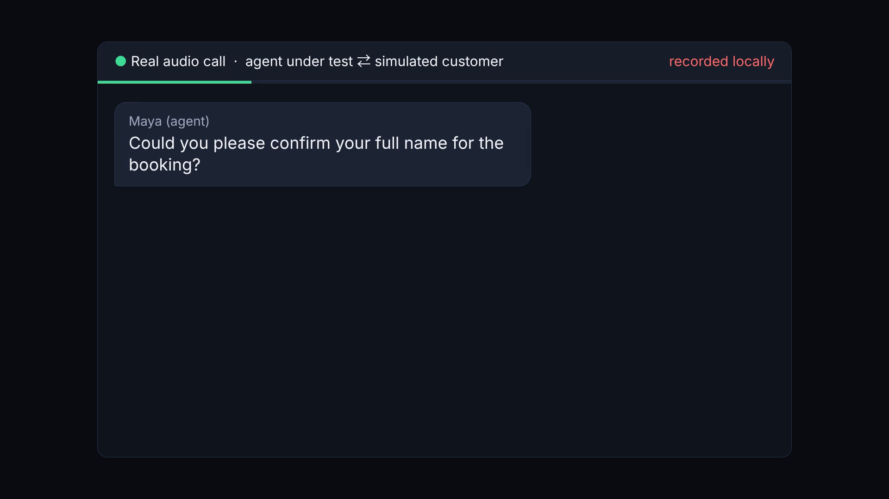

# calleval

**Test a voice agent before your customers do.** calleval makes a simulated customer talk to your agent, has an LLM judge the call against test cases, and shows exactly what passed, what failed, and why, with quoted evidence. It can run the conversation as text (fast, cheap) or as a **real audio call** (finds what text can't: misheard names, awkward number reading, slow replies). Everything runs on your machine; API keys are optional.

[](docs/demo.mp4)

> **Demo video** (64 s, [`docs/demo.mp4`](docs/demo.mp4)): a real call where the agent mishears "Neha Kapoor" as "Ne Kippur" and books under it, the report that catches it with quoted evidence, and a prompt fix generated from the failure.

## What you get
- **Two simulated voice chats**: your agent and a customer persona talk over real audio (local LiveKit server, per-speaker recordings), or over text.
- **LLM-as-judge**: every conversation is judged against criteria. Claude Code judges by default (your subscription); `--llm` uses any OpenAI-compatible model instead.
- **Default test cases** from common voice-AI practice (wrong-day correction, tool failure honesty, language switch, prompt injection, handoff, speakable numbers…), each with its source, plus **your own**: write them, or `calleval gen-cases` writes them from your agent's prompt.
- **A report that shows why**: pass/fail table, chat view with the evidence turns highlighted, the audio, automatic voice analysis (latency, talk-over, cut-off turns, mishearings), and a suggested prompt fix per failure.
- **A self-improving loop**: `calleval improve` turns the failed cases into a new prompt version (never reading held-out cases), so you can re-run and compare.

## Quick start
```bash
git clone https://github.com/SwapnilChand/calleval && cd calleval
./calleval.sh doctor                         # what works, what is missing
./calleval.sh setup --preset free-keys       # or `local` (no keys, needs Ollama); writes calleval.json
./calleval.sh run --agent maya --version v2 --cases relative-date-resolution --runs 1 --run-id first
./calleval.sh judge first --llm              # or let Claude Code judge (see below)
./calleval.sh report first                   # runs/first/report.html
```
Text runs need only Python 3.11+. `free-keys` uses free tiers of Gemini and Groq (add `GEMINI_API_KEY` and `GROQ_API_KEY` to `.env`). For real-audio calls: `./calleval.sh setup --install voice` (about 600 MB, asks first) then `./calleval.sh voice-run --agent maya --version v2 --cases relative-date-resolution --run-id v1`.

## Bring your agent
`calleval new-agent` asks what you are starting from:
1. **From scratch**: a prompt template (`templates/prompt.md`).
2. **A prompt (and tools)**: `calleval new-agent clinic --prompt prompt.md --tools tools.json`.
3. **A LiveKit agent file**: `calleval new-agent clinic --livekit-file agent.py` reads the instructions, the `@function_tool` definitions (types, enums, docstrings) and the speech stack straight from the file (parsed, never executed). See `examples/livekit_agent.py`.

Tools run against a **fake backend** you control (`agent.json`: what each tool returns), never a real system. Cases can force failures (e.g. the booking tool times out).

## Two ways to use it: CLI or Claude Code skill
- **CLI** (`./calleval.sh <command>`): does all the work and works alone. `calleval` with no arguments shows the commands; every command has `-h` with examples. With `judge --llm` and `gen-cases`, the whole loop runs without Claude Code.
- **Claude Code skill** (`.claude/skills/calleval/`): open this folder in Claude Code and ask it to test your agent. It runs the onboarding as a conversation (what are you starting from? which stack?), drafts tool definitions from your prompt and asks you to confirm, writes extra cases, **judges the calls itself** with quoted evidence, and drives the improve loop. It calls the same CLI underneath.

## The loop
`run` (or `voice-run`) → `judge` → `report` → `improve` (new prompt version) → run again, comparing held-out results. See [docs/HOW_IT_WORKS.md](docs/HOW_IT_WORKS.md).

## Stacks (all optional keys)
| Preset | Language models | Speech-to-text | Speech |
|---|---|---|---|
| `local` | Ollama (e.g. `qwen2.5:3b`) | faster-whisper | Piper |
| `free-keys` | Gemini free tier | Groq Whisper | Piper |
| custom | any OpenAI-compatible endpoint | local / Groq / OpenAI-compatible | Piper / Gemini |

## Honest limits
- `agents/maya/v3` is an example of what `calleval improve` produces from a run's failures. It is a **proposal, not a verified improvement**: in a first same-model re-run on three comparable cases v2 and v3 behaved the same (more runs needed). `v2` is the baseline.
- Voice runs rebuild your agent as a "voice twin" (your prompt + tools) on the speech and language services you choose. Audio findings hold for **those** services, not necessarily your production stack.
- Small local models follow long prompts and tools poorly; hosted free tiers are rate-limited. One run per case is a quick look; 3 separates real issues from flukes.
- The LLM judge and the automatic voice flags are hints with evidence, not ground truth. Calibrate against your own listening.
- Piper (local voices) is GPL-3.0 and installed on demand, not bundled. The rest of calleval is MIT.

## Development
`python3 tests/test_loop.py` (no keys), `python3 tests/test_lkimport.py`, `.venv/bin/python tests/test_voice_analyze.py`. The demo video is generated from real captured output by `demo/video/build.py` (HyperFrames).

MIT licensed. Contributions welcome: new default cases (with a `source`), more speech/LLM providers behind the adapters in `calleval/voice/`, importers for other agent formats.
