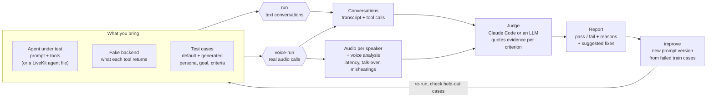
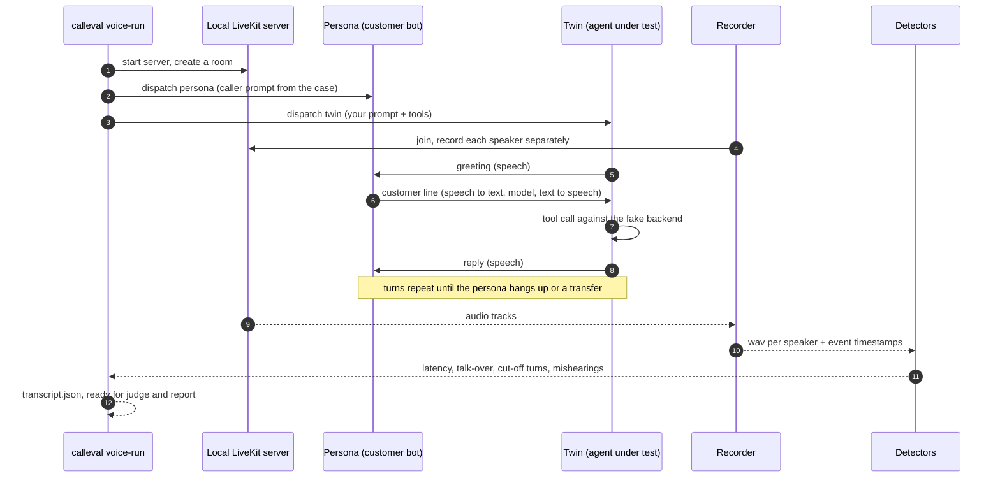

# How calleval works

calleval tests a voice agent's prompt and tools by having a simulated customer talk to it, then judging the conversation. Everything runs on your machine; keys are optional.

## The picture

**The whole loop.** You bring an agent (its prompt and tools, or a LiveKit agent file), a fake backend that answers its tool calls, and test cases. calleval runs conversations as text or as real audio, a judge decides pass or fail with quoted evidence, and the report feeds `improve`, which proposes the next prompt version to re-run.

**What happens in one real-audio call.** The persona (the simulated customer) and the twin (your agent, rebuilt from its prompt and tools) join one room on a local server. Each hears, thinks and speaks like a phone agent would. A recorder keeps each speaker's audio separate, and the detectors read the timing and text afterwards.

## The parts
| Part | What it is | Where |
|---|---|---|
| Agent under test | your prompt + tool definitions + a fake backend that answers the tools | `agents/<name>/vN/{prompt.md,agent.json}` |
| Cases | fixed tests (universal), plus tests generated from your prompt. Each says who the customer is, what they want, what quirk to act out, what must have happened (precondition), the yes/no criteria, and optional hard checks | `cases/**/*.json` |
| Persona | a language model playing the customer | prompted per case |
| Judge | Claude Code (your subscription) reads each conversation and writes a verdict with quoted evidence; a language-model judge is the fallback | `judge_input.md` -> `verdict.json` |
| Report | HTML page: pass/fail table per agent version, chat bubbles, evidence highlighted, audio, fix suggestions | `runs/<id>/report.html` |

## Onboarding (first time)
1. `calleval doctor` shows what works. 2. Say what you are starting from: nothing yet (template), a prompt (+ tools), or a LiveKit agent file (instructions and tools are read from it). `calleval new-agent` asks. 3. Check `agent.json` (which tool plays which role, what each tool returns); then `calleval gen-cases` writes tests from the prompt. 4. Pick a stack with `calleval setup`: `local` (no keys), `free-keys`, or custom. 5. Run one smoke case through judge and report. 6. Optionally install the voice pieces.
The skill does the same as a conversation; the CLI does the work.

## A text run (cheap, fast)
`calleval run`: for each case, the persona and the agent exchange text turns. The agent's tool calls are answered by the mock backend, which validates arguments (types, formats, enums) and can be forced to fail by the case (to test honesty after an error). Output per conversation: `transcript.json`.
Repeats: each case runs several times (`--runs`); one failure in three is FLAKY, two or more is FAIL, so a single unlucky conversation is not a verdict. Hard checks (a tool was or was not called with matching arguments, forbidden words) fail a run immediately.

## A voice run (real audio, still local)
`calleval voice-run`: the same case, but over audio.
1. A local LiveKit server starts. Two workers join one room: the **twin** (the agent under test, rebuilt from your prompt and tools) and the **persona**.
2. Each hears with speech-to-text, thinks with its language model, and speaks with text-to-speech. Between them travels real audio, with real turn-taking and interruptions.
3. A recorder saves each speaker's audio separately, so we know exactly who spoke when.
4. Detectors read the timing and text: response latency, talking over each other, agent turns cut off, repeated sentences, dead air, a tool call with no spoken reply, and what each side's speech-to-text wrote versus what was said (names and numbers). If a Gemini key is set, a listening model also transcribes the agent's audio word for word, to show how numbers and dates were actually spoken.
5. The conversation is written in the same format as a text run, so judging and reporting are identical. The judge also sees the detector flags (as hints, never verdicts).
Limit: the twin is a rebuild, so audio findings hold for the chosen speech and language services, not for your production ones.

## Judging
`calleval judge <run>` writes `judge_input.md` next to each conversation: scenario precondition, criteria, transcript, tool calls, and for voice the analysis. Claude Code reads it and writes `verdict.json`: did the scenario actually happen (if not the run is VOID, not a pass), each criterion pass/fail with a quote and turn number, and a suggested prompt fix. Rules: quotes required, actions count and intent does not, strict grading.

## The improve loop
`calleval improve --agent maya --from <run>` proposes the next version from the failed train-split cases and records what it changed and why (`CHANGES.md`); you can also edit by hand. Fix only from failures on the `train` split. `calleval new-version` copies the prompt to vN+1, you (or Claude Code) change one thing, commit it, re-run the same train cases, then run the held-out cases for both versions. Claim an improvement only if held-out results did not get worse. Versions live in folders and git.

## Files you will see
`agents/` prompt versions, `cases/` tests, `runs/<id>/<agent>-<vN>/<case>/<n>/` per conversation (`transcript.json`, `verdict.json`, `judge_input.md`; voice adds `agent.wav`, `customer.wav`, `audio.mp3`, `analysis.json`, `events-*.jsonl`), `calleval.json` your personal stack choice (gitignored), `.env` your optional keys (gitignored).
